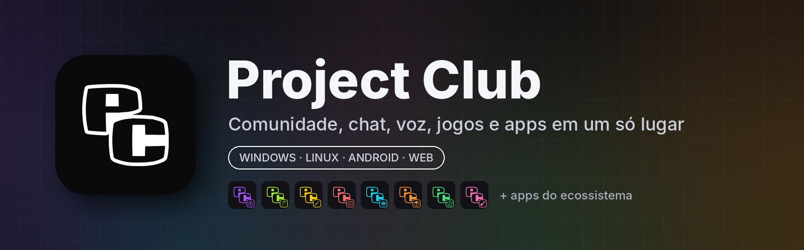

<p align="center"></p>

# Project Club

**Project Club** é uma plataforma de comunidade: chat em canais e mensagens diretas, salas de voz, feed e fórum, eventos, conquistas, níveis, economia, loja e o jogo de cartas **Guerra das Cartas**, tudo em um só lugar. Funciona no navegador e tem apps para **Windows**, **Linux** e **Android**, com atualização automática.

No app de PC, a aba **Apps** instala e mantém atualizados os apps do ecossistema Project Club.

## Principais recursos

- Chat em tempo real com canais, mensagens diretas, menções, reações, anexos, GIFs e emojis
- Salas de voz com cancelamento de ruído (RNNoise)
- Feed, fórum, anúncios e eventos da comunidade
- Perfis, amizades, insígnias, conquistas, níveis, XP e ranking
- Economia com moedas e gemas, loja, missões e recompensas
- **Guerra das Cartas**: jogo de cartas com coleção, decks, campanha e partidas
- Tickets de suporte e painel completo para a staff (cargos, permissões, moderação e automod)
- Notificações e atualização automática nos apps de Windows, Linux e Android

## Baixar

| Plataforma | Download |
|---|---|
| Windows 10/11 (64 bits) | [ProjectClub-Setup-Windows.exe](../../releases/latest/download/ProjectClub-Setup-Windows.exe) |
| Linux (x86_64) | [ProjectClub-Linux.AppImage](../../releases/latest/download/ProjectClub-Linux.AppImage) |
| Android 7+ | [ProjectClub.apk](../../releases/latest/download/ProjectClub.apk) |
| Navegador | [projectclub.squareweb.app](https://projectclub.squareweb.app) |

Todas as versões ficam em [Releases](../../releases).

## Apps do ecossistema

Instalados e atualizados pela aba **Apps** do app de PC. Cada um tem o próprio repositório, com o código, as releases e os créditos do projeto original.

| App | O que é | Base |
|---|---|---|
| [PhotoProject](https://github.com/RiqueBitt/PhotoProject) | Editor de imagem | Patchy (MIT) |
| [CutProject](https://github.com/RiqueBitt/CutProject) | Editor de vídeo | Sprocket (MIT) |
| [WaveProject](https://github.com/RiqueBitt/WaveProject) | Editor de áudio | Audacity (GPL v3) |
| [CanvasProject](https://github.com/RiqueBitt/CanvasProject) | Pintura digital | Krita (GPL v3) |
| [TexelProject](https://github.com/RiqueBitt/TexelProject) | Pintura de texturas 3D | ArmorPaint (zlib) |
| [ForgeProject](https://github.com/RiqueBitt/ForgeProject) | Modelagem, animação e render 3D | Bforartists/Blender (GPL) |
| [ProjectMC](https://github.com/RiqueBitt/ProjectMC) | Launcher de Minecraft | X Minecraft Launcher (MIT) |
| [HyProject](https://github.com/RiqueBitt/HyProject) | Launcher de Hytale | HyPrism (GPL v3) |

## Tecnologias

- **Site e app:** React 18 + Vite
- **Servidor:** Node.js + Express, Socket.IO, Prisma com MySQL, Redis e Backblaze B2
- **App de PC:** Electron (Windows e Linux, com electron-updater)
- **Android:** Capacitor

## Rodar localmente

```bash
npm install          # dependências do servidor e do site (workspaces)
npm run prisma:push  # cria o banco e os dados iniciais
npm run dev          # servidor (porta 3000) e site (porta 5173)
```

Copie `server/.env.example` para `server/.env` e preencha as variáveis antes da primeira execução.

## Versões e publicação

Cada push na `main` que mexe no app gera uma versão `vX.Y.Z` (Conventional Commits). O workflow **Build Apps** compila Windows, Linux e Android e publica a release **neste repositório**. As versões a partir da v1.2.11 estão em [Releases](../../releases).

## Documentação técnica

Arquitetura de armazenamento, voz (RNNoise e TURN), painel da staff, economia, níveis, casas e figurinhas: [docs/ARQUITETURA.md](docs/ARQUITETURA.md).
